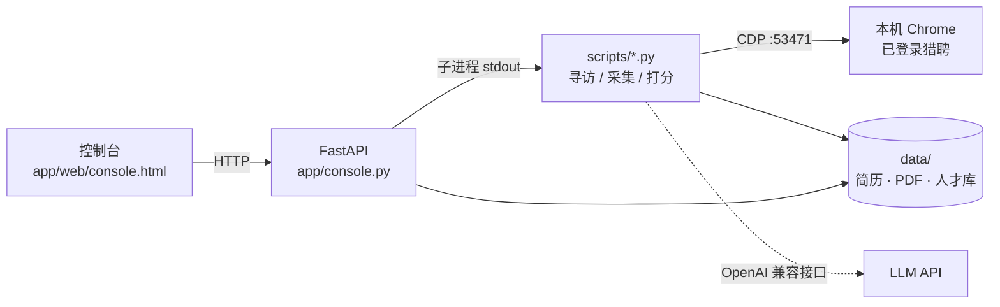

# 猎聘人才寻访自动化工具 · Liepin Talent Scout

> 一次搜索定名单 → AI 打分排序 → 对最匹配的人主动沟通 → 自动索要联系方式 → 简历入库

**Python 3.10+ · Windows · MIT License · 本机运行，数据不出本机**

一个基于浏览器自动化的招聘寻访工作台。它驱动**你自己的** Chrome 操作猎聘猎头端，
把「搜索 → 筛选 → AI 打分 → 主动沟通 → 索要联系方式 → 简历入库」串成一条流程，
并提供一个本地网页控制台查看每一步的进度与结果。

---

## ⚠️ 使用前必读（免责声明）

- 本项目**仅供技术学习与研究**。仓库中**不含**任何真实账号、Cookie、登录态、API Key、
  候选人简历、聊天记录或人才库数据；`data/` 下的所有内容都在你自己的机器上运行时生成。
- 使用前请自行阅读并遵守猎聘（liepin.com）的服务条款。自动化操作可能触发平台风控，
  导致账号被限制或封禁，**全部风险由使用者自行承担**。作者不提供绕过验证码或反爬的能力。
- 请勿用于批量骚扰、未经授权抓取个人信息，或任何违反《中华人民共和国个人信息保护法》
  的用途。候选人简历含个人敏感信息，采集、存储、转发前请确保已取得合法授权。
- 平台改版会导致 CSS 选择器失效，项目不保证长期可用；遇到问题请自行适配或提 Issue。
- 作者不对任何第三方平台、账号或数据的使用后果承担责任。

---

## 主要功能

| 模块 | 说明 |
|---|---|
| **一键寻访** | 一次搜索定名单（关键词 + 在发布岗位），AI 逐个打分排序，按采集时的卡片索引**直接在同一批结果上**点「立即沟通」，不再重新搜索导致找不到人 |
| **岗位筛选** | 支持「展开更多职位」里折叠的全部岗位；用 JS click 命中并校验 `li.job.active`（坐标点击会被 `overflow:hidden` 裁剪） |
| **打招呼语 / 自定义话术** | 弹窗内按关键词选平台话术；全部会话建完后统一发送自定义话术，结果页在整个沟通阶段保持不刷新 |
| **索要联系方式** | 会话建立后统一索要手机 / 微信 / 简历 |
| **批量采集简历** | **只采集对方已回复手机号 / 微信的会话**，导出带头像与基本信息的 PDF，并自动写入人才库 |
| **人才库** | SQLite 索引，支持按姓名 / 城市 / 公司 / 技能检索，带状态标注与备注 |
| **风控护栏** | 随机节奏、单次动作上限、每 N 步主动体检，命中验证码即停 |
| **本地控制台** | 响应式网页界面，实时日志、阶段进度、结果表格、模型配置 |

## 架构



控制台不重写业务逻辑，而是把已验证的 CLI 脚本包成子进程，逐行把 stdout 推到前端，
等于把终端搬进网页。子进程每次重新加载，改脚本无需重启服务。

## 快速开始

**前提**：Windows 10/11、Python 3.10+、Google Chrome、猎聘猎头端账号、
一个 OpenAI 兼容接口的 LLM API Key（DeepSeek / 通义 / Kimi / OpenAI 均可）。

```bash
# 1. 安装依赖（首次）
install.bat                      # 或：python -m venv .venv && .venv\Scripts\pip install -r requirements-real.txt

# 2. 启动（会打开一个 Chrome 窗口，请在里面登录猎聘并保持窗口开着）
start.bat

# 3. 浏览器打开
#    http://127.0.0.1:8898
```

`start.bat` 做两件事：用独立 profile 启动带 `--remote-debugging-port=53471` 的 Chrome，
再启动 `python -m app.console`。也可以手动执行：

```bash
python -m app.console            # 控制台 http://127.0.0.1:8898
python -m scripts.auto_hunt --query AI --posted-job "杭州" --limit 1 --dry
python -m scripts.collect_all --scan
```

**首次使用**：打开控制台 → 右上「设置」→ 填写 API Key、模型名、接口地址（要带 `/v1`）
→ 测试连接 → 保存。配置只写入本机 `.env`。

详细图文步骤见 [`docs/使用说明.html`](docs/使用说明.html)。

## 配置

复制 `.env.example` 为 `.env`，或直接在控制台「设置」里填写：

| 变量 | 说明 |
|---|---|
| `LLM_API_KEY` | OpenAI 兼容接口的 Key |
| `LLM_MODEL` | 模型名，如 `deepseek-chat` |
| `LLM_BASE_URL` | 接口地址，需带 `/v1` |

`config/*.yaml` 是运行参数（节奏、阈值、模式）。控制台只监听 `127.0.0.1`，不对外暴露。

## 目录结构

```
app/          FastAPI 控制台、人才库、LLM 封装、风控护栏、网页界面
scripts/      一键寻访、岗位筛选、简历采集、AI 打分、探测工具
config/       运行参数
tests/        71 项回归测试（unittest，无需浏览器）
docs/         中文图文使用说明
data/         运行时生成（已在 .gitignore 中，仓库只保留 .gitkeep）
```

## 测试

```bash
python -m unittest discover -s tests -p "test_*.py"   # 71 项
python -m scripts.smoke_test                          # 模拟链路冒烟
```

测试使用假页面 / 离线快照，不连接真实账号、不发送任何消息。

## 已知限制

- 仅支持 Windows + 系统 Chrome（有头模式）；无头模式与云代理不在支持范围。
- 详情页专属字段（性别、年龄、工作年限）不在聊天侧栏里，导出 PDF 的头部只恢复侧栏可用字段。
- 末尾统一发送话术/索要时按姓氏匹配会话，同姓多人可能跳过（宁可不发也不发错人）。
- 平台改版后需重新校准选择器；项目内置风控护栏但不承诺规避平台检测。

## 贡献

见 [CONTRIBUTING.md](CONTRIBUTING.md)。**任何 PR 都不要包含真实账号数据、Key、简历或聊天记录。**

## License

[MIT](LICENSE) © 2026 strivelll — 详见文件。使用前请务必阅读上方免责声明。
